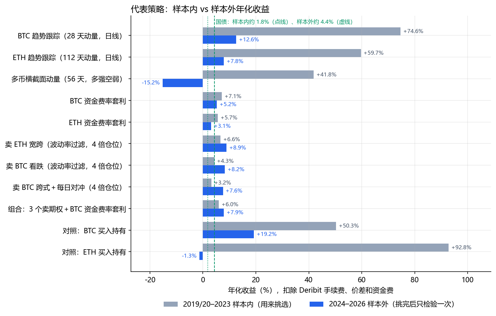
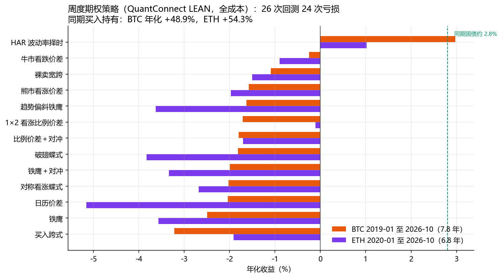
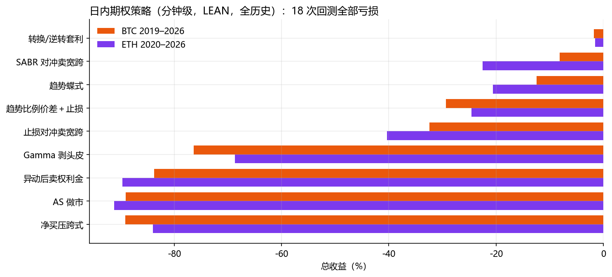
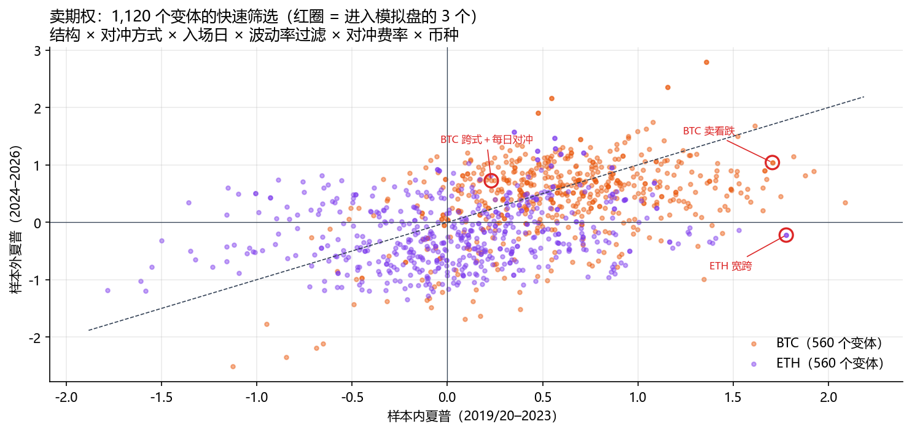
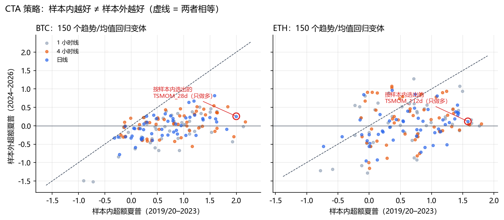
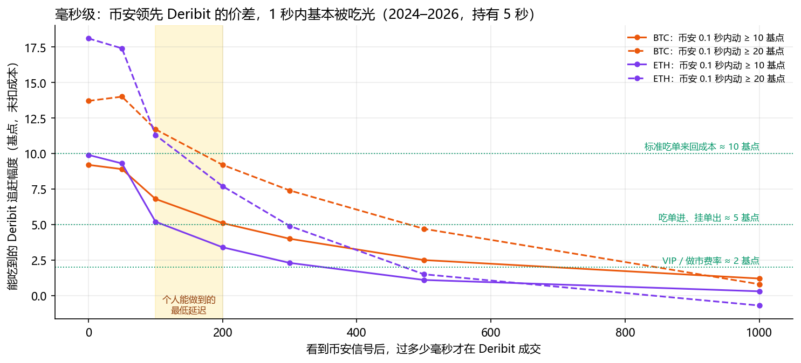
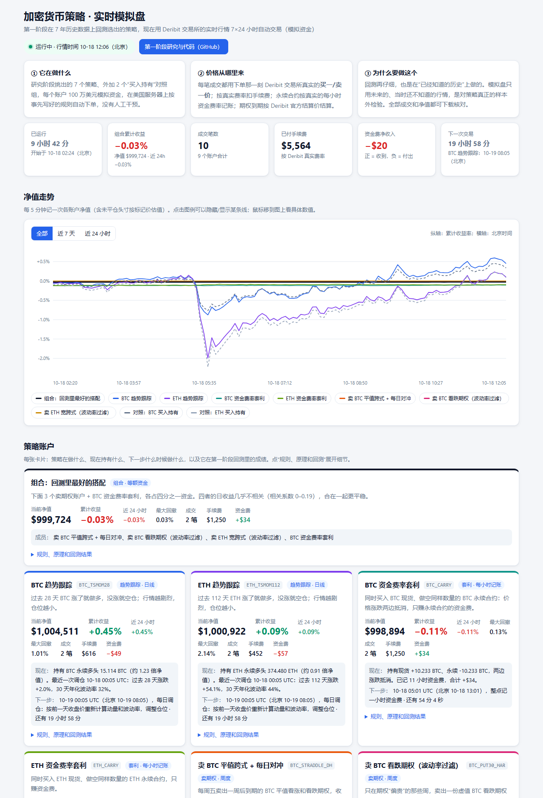

# 加密货币期权与永续合约：多时间维度量化策略研究

**Deribit BTC / ETH · 2019–2026 · QuantConnect LEAN · 1,632 个策略变体 · 实时模拟盘**

> **实时模拟盘（任务二）：<http://107.174.78.165:18090>**
> 第一阶段选出的策略，正在美国服务器上用 Deribit 交易所的实时买一/卖一价 7×24 小时自动交易（模拟资金，页面只读，每 30 秒更新）。

[完整研究报告](docs/REPORT.md) · [相对原项目的逐项修正](docs/FIXES.md) · [模拟盘说明](docs/PAPER_TRADING.md) · [全部结果文件](results/)

---

## 一页总结

| 问题 | 回答 |
|---|---|
| **跑了多少个策略？** | **1,632 个策略变体**，分属 **16 个策略家族**，覆盖**毫秒、秒、分钟、小时、日、周** 6 个时间维度（见[第一节](#一跑了哪些策略结果如何)）。 |
| **回测引擎是什么？** | **QuantConnect LEAN**：开源、事件驱动的机构级回测引擎，用官方 Docker 镜像并按校验码锁定版本。期权策略的全成本回测都在 LEAN 里做，共 **107 次**。需要扫上千个参数组合或几亿笔逐笔数据的研究，用向量化 Python 做，再和 LEAN 交叉核对（见[第二节](#二回测引擎)）。 |
| **数据是什么？** | **Deribit 官方历史数据**：期权逐笔成交（BTC 2,846 天、ETH 2,481 天）、永续合约 1 分钟线和 **5.2 亿笔逐笔成交**、每日官方结算价、每小时资金费率、实时盘口快照。另有**币安公开数据**：20 个币的日线和资金费率、毫秒级逐笔成交（见[第三节](#三数据)）。 |
| **怎么保证可信？** | 参数只用 2019–2023 年挑选，2024–2026 年只检验一次。LEAN 的 **33.2 万笔期权成交、5.07 万次到期结算全部逐笔核验**。另外绕开 LEAN 独立重算，逐周相关系数 0.99；每笔成交价都和同一合约的真实成交价做了对照（见[第四节](#四怎么防止回测骗自己)）。 |
| **结论是什么？** | 大多数策略扣除真实成本后都亏钱。在两段时间都跑赢国债的，是赚风险补偿的**卖期权**和 **BTC 资金费率套利**：两者的组合样本外年化 +7.9%，最大回撤 7.5%。趋势跟踪在样本内极强，样本外明显衰减。秒级和毫秒级的机会真实存在，但 1 秒之内就被专业机构拿走（见[第六节](#六主要发现)）。 |
| **模拟盘在哪看？** | **<http://107.174.78.165:18090>**。7 个策略加 2 个对照组，每个账户 100 万美元模拟资金。每笔成交都按下单那一刻 Deribit 真实的买一/卖一价计算，扣真实手续费，记真实资金费，期权按官方结算价结算（见[第五节](#五实时模拟盘任务二)）。 |



<sub>年化收益已扣除 Deribit 手续费、买卖价差和资金费。灰色是用来挑选参数的样本内年份；蓝色是挑完之后只检验一次的样本外年份。</sub>

---

## 一、跑了哪些策略，结果如何

### 1. 总览：16 个策略家族、1,632 个变体

"变体"指一组完整确定的规则：入场、出场、参数、币种全部固定。样本内：BTC 为 2019–2023 年，ETH 为 2020–2023 年（毫秒级和 1 秒级研究为 2021–2023 年）。样本外：2024-01 至 2026-10。

| 时间维度 | 策略家族 | 变体数 | 引擎 | 代表结果：样本内 → 样本外 | 结论 |
|---|---|---:|---|---|---|
| 毫秒 | 跨交易所领先滞后：币安先动，在 Deribit 跟进 | 54 | Python，毫秒逐笔 | 币安 0.1 秒内动 ≥ 10 基点后，延迟 100–200 毫秒跟进，每笔能吃到 +4 到 +7 基点（未扣费），两段一致 | 现象真实、稳定；但标准吃单来回要 10 基点，需要更低费率和伦敦服务器 |
| 秒 | 1 秒领先滞后（币安现货 → Deribit） | 24 | Python | 晚 1 秒进场只剩 1–5 基点 | ✗ 不够付手续费 |
| 秒 | 价格规则：急涨急跌顺势、期现价差回归、8 个特征的线性预测 | 6 | Python，5.2 亿笔逐笔 | 每笔净收益（BTC）：−11.3 → −12.5、−11.1 → −11.3、+3.6 → +5.4 基点（t 只有 0.2–0.6） | ✗ |
| 秒 | 挂单进场（Deribit 永续挂单免费） | 2 | Python | 每笔 −7.2 → −6.6 基点（BTC） | ✗ 逆向选择 |
| 秒 | 期权大单之后跟随做市商的对冲方向 | 10 | Python | 晚 1 秒跟进，60 秒内只剩 0.3–1 基点 | ✗ |
| 秒 | 暴跌暴涨后挂限价单"接针" | 24 | Python | 样本内所有变体都亏（每笔 −7 到 −18 基点） | ✗ 按规则不能用样本外挑选 |
| 分钟 | 周五 08:00 结算前后的价格规律 | 24 | Python | 6–10 基点，和成本相当，而且是 24 组里挑出来的 | ✗ |
| 分钟 | 日内期权：Gamma 剥头皮、做市、平价套利等 9 个 | 18 | **LEAN** | 全历史（7.8 年 / 6.8 年）18 次全部亏损：−1.5% 到 −91% | ✗ |
| 小时 | CTA：时间序列动量、均线、通道突破、RSI 反转 | 200 | Python | 4 小时线挑出 BTC 28 天动量：年化 +75%（夏普 2.17）→ +7.4%（夏普 0.10） | 明显衰减 |
| 日 | CTA（同上，日线） | 100 | Python | BTC 28 天动量：+75%（夏普 2.00）→ **+12.6%**（回撤 31%）；ETH 112 天：+60% → **+7.8%**（回撤 43%） | 跑赢国债，但衰减明显，回撤大 |
| 日 / 周 | 多币种横截面动量（20 个币） | 12 | Python | 56 天"多强空弱"：+41.8%（夏普 0.93）→ **−15.2%** | ✗ 样本外失效 |
| 日 | 资金费率套利（买现货、空永续） | 4 | Python | BTC：+7.1% → **+5.2%**；ETH：+5.7% → +3.1% | ✓ BTC 跑赢国债；ETH 样本外低于国债 |
| 周 | 原项目的周度期权结构（13 个 × 2 币） | 26 | **LEAN** | 26 次里 24 次亏损；最好的 HAR 择时 BTC 年化 +3.0%，约等于国债 | ✗ |
| 周 | 卖期权：结构 × 对冲 × 入场日 × 波动率过滤 × 费率 × 币种 | 1,120 | Python 筛选 → **LEAN** | 选出 3 个，4 倍仓位：+3.2% ~ +6.6% → **+7.6% ~ +8.9%** | ✓ 小幅、较稳定的优势 |
| 周 | 周末效应：周五卖、周一买回 | 6 | Python | BTC 对冲后每周 −0.19% → −0.31% | ✗ |
| 组合 | 3 个卖期权 + BTC 资金费率套利 | 2 | Python（LEAN 日收益） | +6.0%（回撤 9.0%）→ **+7.9%（回撤 7.5%）** | ✓ 最好，但有选择偏差 |
| | **合计** | **1,632** | | | |

各家族全部变体的逐条结果：[CTA](results/analysis/cta_results.csv)、[卖期权筛选](results/analysis/screen_volsell_variants.csv)、[横截面动量](results/analysis/xsmom_results.csv)，以及 [results/lean/](results/lean/) 里的全部 LEAN 回测 JSON。

**对照基准**：
- BTC 买入持有：2019–2023 年化 +50%（最大回撤 77%）；2024–2026 年化 +19%（最大回撤 54%）。
- ETH 买入持有：+93%（回撤 79%）；−1.3%（回撤 68%）。
- 美国短期国债：约 1.8%（2019–2023）；约 4.4%（2024–2026）。

### 2. 周度期权策略（LEAN 全成本回测，26 次）

每周一 09:30 UTC 按 Delta 选行权价开仓，持有到周五 08:00 UTC 按 Deribit 官方结算价结算。每条腿的名义金额为净值的 25%，本金 100 万美元。

| 策略 | BTC 总收益 | BTC 年化 | BTC 最大回撤 | BTC 手续费 | ETH 总收益 | ETH 年化 | ETH 最大回撤 |
|---|---|---|---|---|---|---|---|
| HAR 波动率择时（HAR-RV 预测 vs 隐含波动率） `HAR_VRP` | +25.7% | +3.0% | 14.0% | $57,679 | +7.2% | +1.0% | 16.3% |
| 牛市看跌价差 `BULL_PUT_SPREAD` | −2.0% | −0.3% | 7.4% | $59,952 | −5.9% | −0.9% | 9.4% |
| 裸卖宽跨（0.20 Delta） `SHORT_STRANGLE` | −8.2% | −1.1% | 17.7% | $60,353 | −9.8% | −1.5% | 19.1% |
| 熊市看涨价差 `BEAR_CALL_SPREAD` | −11.7% | −1.6% | 15.0% | $56,116 | −12.6% | −2.0% | 14.8% |
| 趋势偏斜铁鹰 `TREND_SKEWED_CONDOR` | −12.0% | −1.6% | 16.5% | $100,336 | −22.2% | −3.6% | 22.6% |
| 1×2 看涨比例价差 `CALL_RATIO_SPREAD` | −12.6% | −1.7% | 18.1% | $97,747 | −0.7% | −0.1% | 21.4% |
| 比例价差＋永续对冲 `CALL_RATIO_SPREAD_HEDGED` | −13.2% | −1.8% | 17.2% | $155,746 | −11.0% | −1.7% | 16.4% |
| 破翅蝶式 `BROKEN_WING_BUTTERFLY` | −13.3% | −1.8% | 15.4% | $103,274 | −23.3% | −3.8% | 23.7% |
| 铁鹰＋永续对冲 `IRON_CONDOR_HEDGED` | −14.5% | −2.0% | 15.8% | $163,713 | −20.6% | −3.3% | 21.4% |
| 对称看涨蝶式 `CALL_BUTTERFLY` | −14.7% | −2.0% | 15.4% | $111,866 | −16.8% | −2.7% | 18.9% |
| 日历价差 `CALENDAR_SPREAD` | −14.9% | −2.0% | 18.2% | $66,884 | −30.2% | −5.2% | 30.2% |
| 铁鹰（0.20/0.07 Delta） `IRON_CONDOR` | −17.9% | −2.5% | 21.6% | $99,547 | −21.9% | −3.6% | 22.7% |
| 买入跨式 `LONG_STRADDLE` | −22.5% | −3.2% | 35.8% | $63,340 | −12.3% | −1.9% | 26.5% |

BTC 的回测区间是 2019-01 至 2026-10（7.8 年），ETH 是 2020-01 至 2026-10（6.8 年）。



**为什么几乎都亏？** 原因是期权价格基本公道。2019–2026 年，BTC 周度期权入场时的平值隐含波动率平均为 59.4%，之后的实际波动率为 62.1%。卖方的平均毛利不到权利金的 7%，正好被手续费（约 4%）和半个买卖价差（2%–4%）吃掉。HAR 择时唯一为正，但全部利润来自 5 个暴涨暴跌的周，去掉之后就是小幅亏损。

另外做了两项检查：
- **价差敏感性**：按中间价成交、完全不付价差，裸卖宽跨、对称蝶式、铁鹰在 7.8 年里仍分别亏 5.5%、7.2%、13.9%。
- **真实成交价对照**：把 LEAN 的成交价全部换成真实成交价，没有一个亏损策略变成盈利。

见[报告第三节、第九节](docs/REPORT.md)。

### 3. 日内期权策略（分钟级，LEAN，全历史 18 次）

| 策略 | BTC 总收益（2019-01 至 2026-10） | BTC 手续费 | ETH 总收益（2020-01 至 2026-10） | ETH 手续费 |
|---|---|---|---|---|
| 转换/逆转套利 `PARITY_CONVERSION_ARB` | −1.7% | $66,455 | −1.5% | $61,535 |
| SABR 对冲卖宽跨 `SABR_DELTA_HEDGED_STRANGLE` | −8.2% | $227,998 | −22.5% | $196,358 |
| 趋势蝶式 `TREND_BUTTERFLY` | −12.5% | $124,972 | −20.6% | $100,448 |
| 趋势比例价差＋4% 止损 `TREND_RATIO_SPREAD_STOP` | −29.4% | $93,757 | −24.6% | $88,025 |
| 止损式对冲卖宽跨 `SHORT_STRANGLE_STOP_HEDGE` | −32.4% | $405,799 | −40.3% | $466,944 |
| Gamma 剥头皮 `GAMMA_SCALPING` | −76.4% | $433,493 | −68.7% | $483,347 |
| 异动后卖权利金 `POST_SPIKE_PREMIUM_SELL` | −83.7% | $413,707 | −89.7% | $435,656 |
| Avellaneda–Stoikov 做市 `AS_MARKET_MAKING` | −89.1% | $229,262 | −91.2% | $225,169 |
| 净买压跨式（订单流） `NBP_FLOW_STRADDLE` | −89.2% | $297,702 | −84.0% | $286,977 |
| 对照：买入持有 | +2,120.6% | $500 | +1,794.7% | $500 |



这里逐笔核验了 27.5 万笔期权成交和 1.1 万次到期结算。
- **高频对冲吃掉了利润。** Gamma 剥头皮按规则 7×24 小时不停地对冲，几年下来手续费累计 40 多万美元。
- **做市遇到逆向选择。** 做市的被动成交恰好发生在价格对自己不利的时候。

这一组另外还跑了 ETH 一年期（2025-10 至 2026-10）和 5 天窗口，结论相同，见[报告第四、五节](docs/REPORT.md)。

### 4. 卖期权：1,120 个变体筛选出 3 个

**第一步：快速筛选。** 直接在原始数据上算 1,120 个变体：
- 7 种结构：平值跨式、宽跨、看跌、铁蝶等；
- 5 种对冲方式；
- 周一或周五入场；
- 4 种隐含波动率过滤；
- 吃单或挂单对冲；
- BTC 或 ETH。

**第二步：挑选。** 只用样本内年份挑选，规则是 t ≥ 2，且至少 60% 的年份赚钱。

**第三步：全成本回测。** 挑出的变体在 LEAN 里重跑。

| 策略 | 25% 仓位：样本内 | 25% 仓位：样本外 | 4 倍仓位：样本内（回撤） | 4 倍仓位：样本外（回撤） |
|---|---|---|---|---|
| 卖 ETH 0.25 Delta 宽跨，周一，只在平值 IV ≥ 1.1 × HAR 预测时卖 | +3.4% | +2.4% | +6.6%（3.4%） | **+8.9%（13.8%）** |
| 卖 BTC 0.30 Delta 看跌，周一，同样的波动率过滤 | +1.6% | +2.1% | +4.3%（18.6%） | **+8.2%（14.0%）** |
| 卖 BTC 平值跨式，周五，每天 08:00 用永续对冲 | +2.0% | +2.0% | +3.2%（24.5%） | **+7.6%（17.1%）** |
| ETH 宽跨 + 每 4 小时对冲 | +1.5% | +0.2% | — | — |
| BTC 0.40 Delta 看跌，每 4 小时对冲，IV ≥ HAR 才卖（周五） | +1.3% | +0.2% | — | — |
| ETH 平值跨式，每天对冲（周五） | −2.3% | +1.1% | — | — |
| BTC 0.40 Delta 看跌，每 4 小时对冲，不过滤（周五） | +0.8% | −1.3% | — | — |

样本内：BTC 为 2019–2023 年，ETH 为 2020–2023 年。



**注意以下三点：**
- **BTC 跨式的样本外不算完全没看过。** 这个结构是先在全样本的市场研究里发现的（见报告第九节第 3 点），所以 2024–2026 年的数据对它来说并非完全陌生。
- **ETH 宽跨的样本外证据最弱。** 快速筛选里它的样本外是 −0.7%/年（开仓 29 周）；LEAN 全成本回测里是 +2.4%/年（开仓 42 周）。差别来自两种方法取隐含波动率的方式不同，导致过滤出来的开仓周不一样。
- **这些只是"小幅优势"，不是稳赚。** 卖期权的本质是承担暴涨暴跌的尾部风险：4 倍仓位下回撤可达 14%–25%。

### 5. 资金费率套利（买现货、空永续）

| | 2019–2023 | 2024–2026 |
|---|---|---|
| BTC：一直持有 | +7.1%/年（回撤 3.3%） | +5.2%/年（回撤 0.3%） |
| BTC：只在过去 7 天平均资金费为正时持有 | +7.3% | +4.0% |
| ETH：一直持有 | +5.7%（回撤 5.6%） | +3.1%（回撤 0.6%） |
| ETH：只在过去 7 天平均资金费为正时持有 | +7.3% | +1.7% |

按 1.2 倍本金计算（现货加保证金缓冲）。逐年看，2025–2026 年已经接近甚至低于国债。这类策略的风险不在价格波动，而在交易所违约、暴涨时空单要追加保证金，以及资金费长期为负。逐年结果见 [funding_carry.txt](results/analysis/funding_carry.txt)。

### 6. 组合：3 个卖期权（4 倍仓位）+ BTC 资金费率套利，等额资金

四个部分的日收益几乎不相关，相关系数在 0 到 0.19 之间。

| | 2020–2023 | 2024–2026 |
|---|---|---|
| 年化收益 | +6.0% | **+7.9%** |
| 年化波动 | 5.7% | 5.7% |
| 最大回撤 | 9.0% | **7.5%** |
| 同期国债 | 约 1.8% | 约 4.4% |

这个组合每年比国债多 3.5–4 个百分点，扣除国债后的夏普约为 0.6–0.7。

**有选择偏差。** 3 个期权策略是看过两段结果之后挑出来的，所以 2024–2026 年的数字偏乐观。实时模拟盘就是对它的真正前向检验。

### 7. CTA：趋势跟踪和均值回归（1 小时 / 4 小时 / 日线，300 个变体）

规则家族：
- 时间序列动量：6 个回看期；
- 均线交叉：4 组；
- 唐奇安通道突破：2 组；
- RSI(2) 均值回归。

前三类每条规则都有"多空"和"只做多"两个版本；全部规则再分"按波动率调仓位"和"不调"两种，合计每个币每个周期 50 个变体。成本按 Deribit 永续 0.05% 吃单费加 1 基点滑点，持仓计真实资金费。信号在 K 线收盘时算，下一根 K 线开盘时成交，不用未来数据。

| 币 | 周期 | 按样本内夏普选出的规则 | 样本内：年化 / 夏普 / 回撤 | 样本外：年化 / 夏普 / 回撤 | 全部 50 个变体的样本外夏普中位数 |
|---|---|---|---|---|---|
| BTC | 1 小时 | 28 天动量，只做多，波动率目标 | +71.9% / 2.13 / 33.7% | +3.8% / −0.02 / 46.9% | −0.04 |
| BTC | 4 小时 | 28 天动量，只做多，波动率目标 | +75.0% / 2.17 / 41.0% | +7.4% / 0.10 / 38.0% | 0.05 |
| BTC | 日线 | 28 天动量，只做多，波动率目标 | +74.6% / 2.00 / 36.4% | **+12.6% / 0.26 / 31.4%** | −0.01 |
| ETH | 1 小时 | 20 天通道突破，只做多 | +102.4% / 1.76 / 38.2% | +4.3% / −0.00 / 51.0% | 0.09 |
| ETH | 4 小时 | 20 天通道突破，只做多 | +102.8% / 1.80 / 39.4% | +6.4% / 0.06 / 52.1% | 0.18 |
| ETH | 日线 | 112 天动量，只做多，波动率目标 | +59.7% / 1.58 / 29.1% | **+7.8% / 0.12 / 43.3%** | 0.03 |

夏普均为扣除国债后的超额夏普。



2019–2023 年趋势跟踪的夏普高达 2，和学术界"加密货币趋势很强"的结论一致。到了 2024–2026 年，行情来回震荡，所有变体都大幅衰减：样本内排第一的规则，样本外只比平均水平略好。日线的两个规则放进了模拟盘。

### 8. 多币种横截面动量（20 个币，币安永续）

每周一按过去 L 天的涨幅排名：做多前 20%、做空后 20%，多空等额。

| 回看期 L | 动量（多强空弱）：样本内 → 样本外 | 反转（多弱空强） | 只做多前 20% |
|---|---|---|---|
| 7 天 | +6.3% → +7.1% | −23.7% → −20.5% | +40.5% → +7.3% |
| 14 天 | +6.6% → −6.4% | −22.8% → −6.5% | +48.7% → −7.1% |
| 28 天 | +29.5% → −21.0% | −34.5% → +12.1% | +91.4% → −23.6% |
| 56 天 | +41.8% → −15.2% | −44.0% → +5.7% | +99.6% → −5.7% |
| 对照：20 个币等权买入持有 | +91.9% → +2.1% | | |

样本内为 2020-07 至 2023 年。Liu、Tsyvinski、Wu（Journal of Finance，2022）发现的币种动量，在 2020–2023 年确实存在；但在 2024–2026 年，按样本内挑出的 28 天和 56 天版本都变成了大幅亏损。另外，币种池是"今天仍然很大的币"，这有幸存者偏差，对策略有利。

### 9. 秒级：只交易永续（5.2 亿笔逐笔成交）

规则在看到 2019–2023 年完整数据之前就已写定，只用 2019 年上半年做设计，之后原样拿到 2024–2026 年检验。

| 每笔净收益（基点，含 1 基点滑点） | BTC 2019–23 | BTC 2024–26 | ETH 2020–23 | ETH 2024–26 |
|---|---|---|---|---|
| 急涨急跌后顺势（持有 5 分钟） | −11.3（30,576 笔） | −12.5（17,900 笔） | −11.2 | −12.2 |
| 期现价差回归（持有 5 分钟） | −11.1（74,355 笔） | −11.3（30,126 笔） | −10.8 | −11.1 |
| 8 个特征的线性预测（超过成本才交易） | +3.6（t = 0.2） | +5.4（t = 0.6） | +32.1（t = 1.3） | +19.9（t = 0.8） |
| 同一预测、改成挂单进场 | −7.2 | −6.6 | −8.2 | −6.1 |

**为什么不赚钱：**
- **毛利太小。** 前两条规则扣成本前每笔平均只赚约 1 个基点，而吃单来回一趟要 10 个基点。
- **线性预测不显著。** 它只在极端行情触发，统计上不显著。
- **挂单进场有逆向选择。** 能成交的恰恰是价格朝不利方向走的时候。

**事件型研究。** 统一假设个人用户晚 1 秒下单，结果都不够付手续费：
- 期权大单后跟进对冲方向；
- 暴跌后挂单接针；
- 跟随币安抢 Deribit 的滞后。

详见[报告第十节第 6 点](docs/REPORT.md)。

### 10. 毫秒级：币安领先 Deribit

样本是 2021–2026 年每 20 天取一天，共 106 天。领先方是币安永续的毫秒逐笔成交，跟随方是 Deribit 永续的逐笔成交。下表是 2024–2026 年、持有 5 秒的数字（基点，未扣成本）：

| 事件（每天约几次） | 0 ms | 100 ms | 200 ms | 300 ms | 500 ms | 1 秒 |
|---|---|---|---|---|---|---|
| BTC：币安 0.1 秒内动 ≥ 10 基点（约 22 次） | +9.2 | +6.8 | +5.1 | +4.0 | +2.5 | +1.2 |
| BTC：≥ 20 基点（约 3 次） | +13.7 | +11.7 | +9.2 | +7.4 | +4.7 | +0.8 |
| ETH：≥ 10 基点（约 50 次） | +9.9 | +5.2 | +3.4 | +2.3 | +1.1 | +0.3 |
| ETH：≥ 20 基点（约 7 次） | +18.1 | +11.3 | +7.7 | +4.9 | +1.5 | −0.7 |



- **领先滞后真实且稳定。** 2021–2023 年的数字和上表基本一致。
- **可赚的幅度随延迟快速衰减。** 币安在东京、Deribit 在伦敦，信号单程最快约 100 毫秒，所以 100–200 毫秒基本就是个人能做到的延迟。
- **在这个延迟下要赚钱，费率必须降下来：**
  - 进场吃单、出场挂单（来回约 5 基点）：只有最大的那类事件，每笔约 +3 到 +7 基点；
  - 费率再低到约 2 基点：≥ 10 基点的事件也能转正。
- **这些数字偏乐观。** 表里用的是成交价，做市商的报价通常调整得更早。要确认，需要 Deribit 毫秒级的盘口数据。

### 11. 其他没有通过的想法

- **周末效应**：周五卖平值跨式、周一买回，想赚周末的时间价值。但市场在周五已经把周末的低波动算进了价格，周一隐含波动率会回升（BTC 2024–2026：44.2% → 50.4%）。结果每周亏 0.2%–0.5%。
- **结算窗口**：月末大到期前价格偏弱、结算后反弹，幅度 6–10 基点，和成本相当。而且这是比较了 24 组之后挑出来的，不可靠。

---

## 二、回测引擎

| | 说明 |
|---|---|
| **主引擎** | **[QuantConnect LEAN](https://github.com/QuantConnect/Lean)**：开源（Apache 2.0）、事件驱动的回测和实盘引擎，是 QuantConnect 云平台的底层引擎，也被不少机构和个人用于研究和实盘。用 lean CLI 1.0.229 驱动官方 Docker 镜像，镜像按校验码 `quantconnect/lean@sha256:b34529ae405c2b641010ff742399f56583942523b77bd20052243a78214e1653` 锁定，两台机器上的校验回测结果一致。 |
| **为什么选 LEAN** | 原生支持期权链、欧式行权、现金结算、逐笔/秒/分钟数据、自定义手续费/成交/保证金模型。回测和实盘是同一套代码，而且开源可审计，不是"黑箱"。 |
| **针对 Deribit 做的定制**（[`backtest/*/deribit_common.py`](backtest/DeribitWeekly/deribit_common.py)） | 7×24 小时 UTC 交易时段；合约乘数 1、最小 0.1 BTC / 1 ETH；Deribit 手续费公式；周五 08:00 按官方结算价现金结算；欧式期权不提前指派；永续每小时资金费；报价 = 隐含波动率模型中间价 ± 实时盘口半价差；做市成交必须有真实成交穿过挂价。 |
| **向量化 Python** | 用在 1,120 个卖期权变体的筛选、300 个 CTA 变体、5.2 亿笔逐笔的秒级/毫秒级研究上。逐个跑 LEAN 太慢，所以先用 Python 快速筛选，再把入选的放进 LEAN 全成本复核。 |
| **性能** | 研究机是 AMD Ryzen 9 9950X（16 核）、123 GB 内存。用 py-spy 分析后做了两处优化：跳过 LEAN 每秒对虚拟平仓单的手续费估算，以及关闭期权补线。秒级回测因此快 5–6 倍，成交逐笔不变（[`DeribitIntradayFast4`](backtest/DeribitIntradayFast4/)）。 |

## 三、数据

| 数据集 | 来源 | 区间 / 规模 | 用途 |
|---|---|---|---|
| 期权逐笔成交（含成交时的指数价、标记价、隐含波动率、主动方向、大宗/强平标记） | Deribit 官方历史接口 | BTC 2,846 天、ETH 2,481 天（2019-01 / 2020-01 起） | LEAN 期权报价与成交、独立复核 |
| 永续合约 1 分钟 K 线 | Deribit | 2018-12 至 2026-10 | 对冲工具、CTA、资金费率套利 |
| 永续合约逐笔成交（毫秒时间戳） | Deribit | BTC 3.02 亿笔、ETH 2.14 亿笔（4.3 GB） | 秒级 K 线、秒级/毫秒级研究 |
| 每日 08:00 官方结算价 | Deribit | 全部 | 期权到期结算 |
| 每小时资金费率 `interest_1h` | Deribit | 2019-04-30 起 | 永续持仓成本、资金费率套利 |
| 实时期权盘口快照 | Deribit（2026-10-16 多次抓取） | [results/calibration/](results/calibration/) | 买卖价差模型 |
| USDⓈ-M 永续日线 + 资金费率（20 个币） | 币安 data.binance.vision | 2019-09 至 2026-09 | 横截面动量 |
| BTC/ETH 永续逐笔（aggTrades，毫秒） | 币安 data.binance.vision | 2021–2026 年每 20 天取 1 天，共 106 天 | 毫秒级领先滞后 |
| BTC/ETH 现货 1 秒 K 线 | 币安 data.binance.vision | 2021–2026 年每 10 天取 1 天，共 212 天 | 1 秒级领先滞后 |

原始数据和 LEAN 数据合计几十 GB，没有放进仓库。所有下载和构建脚本都在 [`etl/`](etl/)，可以从公开接口完整重建。

**数据上的两个局限：**
- **没有真实的历史盘口。** 价差用的是 2026 年 10 月的实时盘口，统一套用到所有年份。早年盘口更薄，所以早年成本被低估，这一点对策略有利。为此做了 0、0.5、2 倍价差的敏感性测试。
- **报价是模型价。** 两次真实成交之间用隐含波动率模型重新定价，模型价和同一分钟真实成交价的偏差中位数约 2%–7%。

## 四、怎么防止"回测骗自己"

1. **样本内/样本外分开。** 所有选择都只用 2019–2023 年（ETH 从 2020 年起）的数据做，2024–2026 年只在最后检验一次。表里凡是看过两段数据的，都单独注明。
2. **逐笔核验。** [`verify_v2.py`](backtest/verify_v2.py) 对全部 107 次 LEAN 回测逐笔检查：

   | 检查项 | 数量 | 不符 |
   |---|---:|---:|
   | 期权市价成交价 = 当分钟卖一（买入）/ 买一（卖出） | 101,112 笔 | 2* |
   | 做市成交：等于挂价、有真实成交穿过、数量 ≤ 真实成交量的 25% | 230,927 笔 | 0 |
   | 到期结算价 = 官方结算价下的内在价值 | 50,703 次 | 0 |
   | 手续费符合 Deribit 公式 | 全部市价成交 | 0** |
   | 提前指派、在合约首笔成交前下单、还有未到期期权时平掉对冲 | — | 0 |

   \* 这 2 笔都来自 Deribit 自身的标记价故障（2019-10-31）。
   \*\* 价差敏感性测试里，价差倍数不为 1 时，12.5% 封顶的计算方式会产生很小的偏差；不影响结论。
3. **绕开 LEAN 独立重算。** 只用 Deribit 原始成交重算裸卖宽跨，和 LEAN 的逐周盈亏相关系数为 0.99（[`analysis/indep_weekly.py`](analysis/indep_weekly.py)）。
4. **真实成交价对照。** LEAN 的每一笔期权成交，都和同一合约前后 60 分钟内的真实成交价对比；全部换成真实价格后，没有一个亏损策略变成盈利（[`analysis/lean_vs_prints.py`](analysis/lean_vs_prints.py)）。
5. **机制测试。** 用合成数据检查手续费、结算、欧式行权，每个数都能手算（[`backtest/tests/`](backtest/tests/)）。
6. **查出的 bug 都公开。** 例如平价套利第一次跑出 +9.66%，拆解后发现是对冲腿被提前平掉，修复后是 +0.72%。详见[报告第一节](docs/REPORT.md)。

## 五、实时模拟盘（任务二）

**公网地址：<http://107.174.78.165:18090>**（只读，不需要登录，手机也能看）

[](http://107.174.78.165:18090)

| 账户 | 策略 | 什么时候交易（UTC，北京时间 +8） | 回测依据 |
|---|---|---|---|
| `BTC_TSMOM28` | BTC 趋势跟踪：28 天动量为正就做多永续，否则空仓；仓位 = 40% ÷ 30 天波动率（最多 2 倍） | 每天 00:05 | 第一节 7 |
| `ETH_TSMOM112` | ETH 趋势跟踪：112 天动量，规则同上 | 每天 00:05 | 第一节 7 |
| `BTC_CARRY` / `ETH_CARRY` | 资金费率套利：买现货、空等量永续 | 开始时建仓，之后每小时记资金费 | 第一节 5 |
| `BTC_STRADDLE_DH` | 卖 BTC 平值跨式（下周五到期），每天 08:00 用永续对冲 Delta | 周五 09:00 开仓，周五 08:00 结算 | 第一节 4 |
| `BTC_PUT30_HAR` | 平值 IV ≥ 1.1 × HAR 预测时，卖 BTC 0.30 Delta 看跌 | 周一 09:30 判断，周五 08:00 结算 | 第一节 4 |
| `ETH_STRANGLE25_HAR` | 同样的过滤，卖 ETH 0.25 Delta 宽跨 | 周一 09:30 判断，周五 08:00 结算 | 第一节 4 |
| `BTC_HOLD` / `ETH_HOLD` | 对照：买入持有 | 开始时买入一次 | — |
| 组合 | 3 个卖期权 + BTC 资金费率套利，等额 | — | 第一节 6 |

**怎么运行：**
- 程序 [`papertrade/papertrader.py`](papertrade/papertrader.py) 只用 Python 标准库，在美国 VPS 上以系统服务的形式 7×24 小时运行，崩溃后自动重启。状态存在 SQLite 里，重启不会重复交易。
- 用 Deribit 公共行情接口，不需要账户和 API 密钥，也不下真实订单。
- 每 30 秒检查一次：
  - 永续、期权：买入按卖一价、卖出按买一价成交，扣 Deribit 手续费；
  - 永续持仓：每小时按真实资金费率记账；
  - 期权到期：按 Deribit 官方结算价现金结算。
- 每笔成交都记录了当时的实时报价，方便和 Deribit 历史行情核对。
- 交易进程和网页进程分开。网页进程以无权限的临时用户运行，只能读取交易进程导出的快照文件，不接触数据库，也不能下单。

**网页上能看到：**
- 各账户的净值曲线；
- 每个策略在做什么、现在持有什么、下一步什么时候做什么；
- 第一阶段的回测成绩；
- BTC/ETH 实时盘口、资金费率、平值隐含波动率和 HAR 预测；
- 期权实时报价、全部持仓、成交和资金费记录；
- CSV 导出。

**几点说明：**
- 运行几天到几周的结果只能展示流程，统计上说明不了策略好坏；判断策略主要看第一节的多年回测。
- 卖期权账户只在条件满足时才开仓，有些周会选择不交易，这是规则本身的一部分。

更多说明见 [docs/PAPER_TRADING.md](docs/PAPER_TRADING.md)。

## 六、主要发现

1. **期货的经典策略在加密货币上有效，但不稳定。** 2019–2023 年趋势跟踪的夏普高达 2，和学术界"加密货币动量很强"的结论一致。但 2024–2026 年效果大幅衰减，横截面动量更是直接失效。
2. **期权和高频的难点各不相同。** 期权的问题是定价基本公道而成本高：Deribit 按标的价值收手续费，占便宜期权权利金的比例很高。高频的问题是速度：可赚的部分在 1 秒内就被专业机构拿走了。
3. **能稳定跑赢国债的，都是在赚风险补偿或结构性收入。** 卖期权是替别人承担波动风险，资金费率套利是收加杠杆做多的人付的钱。单靠预测价格方向的策略，在 2024–2026 年都不稳定。
4. **大部分"漂亮回测"来自错误的回测设置。** 原项目的盈利，主要来自错误的时区和交易时段、美式期权建模、几乎为零的手续费和价差、周末持仓等问题（见 [docs/FIXES.md](docs/FIXES.md)）。修正后，原来"7.8 年总冠军"的 +30.8% 变成了 −14.7%。

## 七、仓库结构

```
README.md                 本页
docs/
  REPORT.md               完整研究报告（含全部表格和逐项检验）
  FIXES.md                相对原项目回测的逐项修正
  PAPER_TRADING.md        模拟盘说明
  make_charts.py          本页图表的生成脚本（只读 results/）
  img/                    图表
backtest/                 LEAN 工作区里的代码（不含数据）
  DeribitWeekly/          13 个周度期权策略
  DeribitIntraday/        9 个日内期权策略 + 买入持有
  DeribitIntradayFast/    同上，秒级运行优化版 1（成交逐笔相同，快约 2 倍）
  DeribitIntradayFast4/   同上，优化版 2（成交逐笔相同，快 5–6 倍）
  DeribitVolSell/         卖期权研究策略（结构、对冲、入场、过滤均为参数）
  DeribitDataCheck/       数据时间对齐核验
  */deribit_common.py     Deribit 交易场所模型（手续费、成交、结算、资金费、希腊值、SABR）
  run_suite.py            批量运行与统一指标计算
  verify_v2.py            逐笔核验
  make_suites.py, suites/ 每组回测的任务清单（参数事先固定）
  tests/                  LEAN 机制测试（合成数据）
analysis/                 不经过 LEAN 的研究和复核：CTA、横截面动量、资金费率套利、卖期权筛选、
                          组合、秒级/毫秒级、独立重算、真实成交价对照
etl/                      Deribit / 币安数据下载与 LEAN 数据构建
papertrade/               实时模拟盘程序和系统服务配置
results/
  lean/                   107 次 LEAN 回测结果（JSON：参数、LEAN 统计、统一口径指标）
  verify/                 逐笔核验报告
  analysis/               各项研究的输出（TXT / CSV）
  calibration/            盘口快照与价差模型
```

## 八、复现

所需环境：LEAN CLI 和 Docker，Python 3.11 及 numpy、pandas、scipy、pyarrow、requests。

1. 建 LEAN 工作区（注册 Deribit 的 7×24 交易时段、合约乘数和最小手数）：

   ```bash
   python etl/setup_workspace.py <工作区目录>
   ```

2. 下载 Deribit 原始数据（以 BTC 期权成交为例；永续分钟线、逐笔、结算价的命令见 `etl/fetch_deribit.py` 开头的说明）：

   ```bash
   python etl/fetch_deribit.py options --currency BTC --start 2019-01-01 --end 2026-10-16
   ```

3. 构建 LEAN 数据（币种、起始年份、结束日期）：

   ```bash
   bash etl/build_currency.sh BTC 2019 2026-10-16
   ```

4. 把 `backtest/` 下的文件放进工作区，跑一组回测：

   ```bash
   python run_suite.py suites/weekly_btc.json results/weekly_btc.json --workers 3
   ```

5. 逐笔核验：

   ```bash
   python verify_v2.py results/weekly_btc.json results/verify_weekly_btc.json
   ```

6. 不经过 LEAN 的研究，例如 CTA：

   ```bash
   python analysis/cta.py
   ```

脚本里的路径是研究机上的工作区路径（`/mnt/quant_storage/quant_workspace/...`），在别的机器上需要改成自己的目录。

## 参考文献

- Moskowitz, T., Ooi, Y. H., Pedersen, L. H. (2012). *Time series momentum*. Journal of Financial Economics.
- Liu, Y., Tsyvinski, A. (2021). *Risks and returns of cryptocurrency*. Review of Financial Studies.
- Liu, Y., Tsyvinski, A., Wu, X. (2022). *Common risk factors in cryptocurrency*. Journal of Finance.
- Corsi, F. (2009). *A simple approximate long-memory model of realized volatility*. Journal of Financial Econometrics.
- Avellaneda, M., Stoikov, S. (2008). *High-frequency trading in a limit order book*. Quantitative Finance.
- Hagan, P. et al. (2002). *Managing smile risk*（SABR 模型）. Wilmott Magazine.
- Alexander, C., Deng, J., Feng, J., Wan, H. (2023). *Net buying pressure and the information in bitcoin option trades*. Journal of Financial Markets.
- Lucic, V., Sepp, A. (2024). *Valuation and hedging of cryptocurrency inverse options*. Quantitative Finance.
- Almeida, C. 等（2024）. arXiv:2410.15195（BTC 方差风险溢价）.
- O'Donovan, J., Yu, Z. SSRN 4806038（股票期权异象扣除交易成本后的收益）.
- Connors, L., Alvarez, C. (2009). *Short Term Trading Strategies That Work*（RSI(2)）.

---

<sub>本仓库只用于课程研究。模拟盘不涉及真实资金，所有内容都不构成投资建议。</sub>
